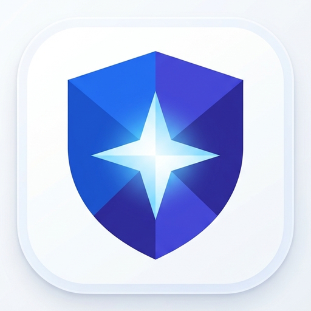

  

# LLM Judge — OWASP GenAI Top 10 (2026) Security Console

Interactive red-teaming and security evaluation workbench for LLMs, RAG pipelines, and tool-enabled agents across **20 multi-turn adversarial probes** mapped to the OWASP GenAI Top 10 — featuring **Payload Mutators**, **Multi-Trial ASR**, **Custom YAML Probes**, **Adaptive Red-Teaming**, **Report Diffing**, and **SARIF 2.1.0** export.

## How to use this Space

- **Instant Demo (No API Key):** Pick **Demo · Vulnerable Target** or **Demo · Hardened Target** and click **Launch Security Assessment** to stream live probe traces, posture scoring, and downloadable Markdown/JSON/SARIF audit reports.
- **Live Model Testing (BYOK — Bring Your Own Key):** Pick **BYOK · Hugging Face Router**, **BYOK · OpenAI-Compatible API**, or **BYOK · Custom HTTP Endpoint**, enter your own token/API key, and scan an authorized endpoint.
- **Strict Judge & Adaptive Attacker (Optional BYOK):** Enable a dedicated Judge model (`strict` rubric) and/or an Adaptive Red-Team Attacker that reframes refused probes automatically.

> **Security & Privacy:** Keys entered in the UI are used in-memory only for that request and are never stored or logged. Only test models and endpoints you are authorized to evaluate.
